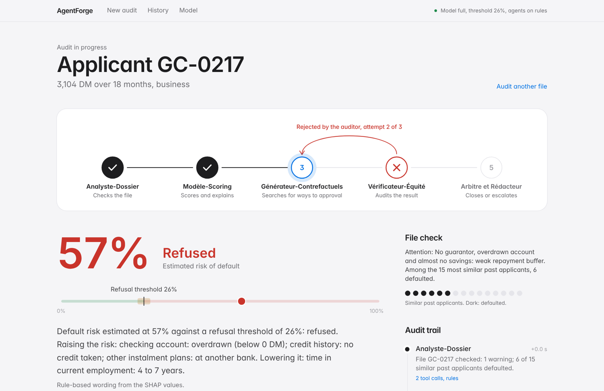

# AgentForge Credit Audit

Multi-agent system that audits a credit scoring decision. Five agents score
a loan file, explain the score with exact SHAP values, search for verified
counterfactuals (the smallest realistic changes that turn a refusal into an
approval), test the decision for fairness and close the file or hand it to
a human reviewer.

Project for the Agentic AI module (topic 42), Master IA, Faculté des
Sciences Ben M'Sik, Université Hassan II de Casablanca.

Team AgentForge: Marouane Daouki, Imane Alouani.



## What it does

```
Analyste-Dossier -> Modèle-Scoring -> Générateur-Contrefactuels -> Vérificateur-Équité -> Arbitre et Rédacteur
                                                 ^                          |
                                                 +--- rejected, new plan ---+
```

| Agent | Role | Tools |
|---|---|---|
| Analyste-Dossier | Checks the file, compares it with past applicants and cites similar past audits | `validate_application`, `similar_cases`, `past_audits` (case store) |
| Modèle-Scoring | Scores and explains | `score_applicant`, `shap_explain` |
| Générateur-Contrefactuels | Plans a search and proposes ways to approval | `permitted_moves`, `generate_counterfactuals` (exhaustive search and DiCE), `closest_miss` |
| Vérificateur-Équité | Audits the decision and re-verifies every proposal, can reject them | `sensitive_flip_test`, `group_fairness_metrics`, `group_context`, `check_actionability`, `rescore_candidates`, `plausibility_score` |
| Arbitre et Rédacteur | Closes the audit or escalates to a human, writes the applicant letter in French | `past_audits` (case store), `escalation_rules`, `render_report` |

Design rules:

- **Numbers come from tools.** The language model plans and words; it never
  produces a score. Its answers pass guards (structure, allowed attributes,
  no number absent from the tool outputs), are retried once with the
  objection, then replaced by rule-based logic. With `LLM_PROVIDER=none`
  every agent runs on rules, so the whole system works without any key.
- **Every counterfactual is re-scored** by the model and checked against
  recourse rules: protected and fixed attributes are never touched, amounts
  and durations only go down, account standing only improves.
- **The loop is real.** When nothing survives the audit, the generator
  receives the objections and must try a different plan: loan terms first,
  then the financial situation, then wider ranges. After three attempts the
  file goes to a human.
- **The auditor trusts nothing.** Every proposal is checked again against
  the recourse rules, re-scored by a fresh model call, required to clear the
  threshold with a margin, and compared with real past applicants
  (plausibility). Fairness is tested on the file (flip test) and measured on
  the model (Fairlearn group metrics).
- **Runs are durable.** Every step is checkpointed in SQLite. An escalated
  audit stops on a LangGraph interrupt until a reviewer answers; a run cut
  by a restart resumes from its last checkpoint. History, events, cases,
  traces and PDF reports are on disk.
- **Memory is used.** Closed audits go to a case store; a similar file
  retrieves them, the analyst cites them, and a near-identical file with the
  opposite outcome is sent to a person.

## Results on the 200 held-out files

| | |
|---|---|
| Scoring model | LightGBM, monotone constraints, Platt calibration. Test AUC 0.806 (95% interval 0.738 to 0.871), cross-validation AUC 0.788 against 0.767 for logistic regression |
| Refusals that leave with a verified way to approval | 78% (77 of 99), every proposal passing recourse rules, re-scoring with a margin and the plausibility check |
| of which solved at attempt 1 / 2 / 3 | 39 / 34 / 4 |
| Files whose decision changes with a protected attribute | 11.0% for the audited model, 0.0% for the variant trained without protected attributes |
| Approval gap between groups (demographic parity difference) | Sex: 9 points, 1 point without protected attributes. Age band: 18 points, 11 points without them, so part of it passes through correlated attributes |
| Time per audit, agents on rules | about 100 ms |

Before the plausibility check was added, 87% of refusals (86 of 99) had a way
to approval. The 9 files of difference only had proposals that no longer
looked like a real applicant.

What the agents bring, same 200 files, every delivered proposal judged by the
same tools ([`eval/results/RESULTS.md`](eval/results/RESULTS.md)):

| System | Proposals delivered | of which sound | Refusals with a sound way | Refusals handed an unsound proposal | Sensitive dependence caught |
|---|---|---|---|---|---|
| Five agents with the loop | 131 | 100% | 78% | 0% | 22 of 22 |
| Without the rejection loop | 58 | 100% | 39% | 0% | 22 of 22 |
| Without the auditor agent | 90 | 64% | 39% | 22% | 0 of 22 |
| Model + DiCE, no agents | 395 | 12% | 35% | 100% | 0 of 22 |

The 100% of the first two rows holds by construction, since the auditor
applies these checks. The baseline through a single prompt needs a provider
key and is not run yet.

Details and figures: [`ml/reports/MODEL_CARD.md`](ml/reports/MODEL_CARD.md).

## Run it

Backend (Python 3.11 or later):

```
cd backend
python -m venv .venv
.venv\Scripts\activate        # Windows; on macOS/Linux: source .venv/bin/activate
pip install -r requirements.txt
pytest
uvicorn app.main:app --reload
```

Interface (Node 20 or later), in a second terminal:

```
cd frontend
npm install
npm run dev
```

The interface opens on http://localhost:5173 and calls the API on port 8000.
The trained model and the prepared data are in the repository, so nothing
has to be downloaded or trained first.

The backend keeps its state in `backend/data/` (created on first run, never
committed): `audit.sqlite` (runs, events, case store), `checkpoints.sqlite`
(LangGraph checkpoints), `traces/` (one JSONL file per run) and `reports/`
(PDF). Delete the folder to start from an empty history; `DATA_DIR` moves it.

### Evaluation and sample reports

```
python eval/run_eval.py        # result tables: full system, ablations, baselines (about one minute)
python eval/demo_reports.py    # PDF audit report of the six demo files, in docs/sample-reports/
```

### Language model (optional)

Copy `.env.example` to `backend/.env` and set a provider. Gemini, Groq and a
local Ollama are supported through their OpenAI-compatible endpoints. The
top bar of the interface shows whether the agents run on a model or on rules,
and each step of the audit trail says which one produced it. Free-tier
limits and the matching `LLM_MIN_INTERVAL_SECONDS` are in
[`docs/llm-limits.md`](docs/llm-limits.md).

### Rebuild data, model and reports

```
pip install -r backend/requirements-ml.txt
python ml/prepare_data.py      # decode the raw file, split train / test
python ml/train.py             # train both variants, calibrate, choose thresholds
python ml/select_samples.py    # pick the six demo files from the test set
python ml/report.py            # figures, model card, audit statistics
```

## Repository layout

| Path | Content | Owner |
|---|---|---|
| `backend/app/domain/` | Attribute definitions, encoder, model runtime | Marouane |
| `backend/app/tools/scoring.py`, `counterfactuals.py`, `analysis.py` | Model, SHAP, counterfactual search, file analysis | Marouane |
| `backend/app/agents/` (first three), `agents/base.py`, `llm/` | Agents, guards, LLM client | Marouane |
| `ml/` | Data, training, reports, notebook | Marouane |
| `frontend/` | React, TypeScript and Tailwind interface | Marouane |
| `backend/app/tools/fairness.py`, `report.py` | Fairlearn metrics, plausibility, PDF report | Imane |
| `backend/app/agents/` (last two), `domain/fr.py` | Vérificateur-Équité, Arbitre et Rédacteur, French wording of the letter | Imane |
| `backend/app/graph/` | Graph, step records, JSONL trace, durable runner | Imane |
| `backend/app/memory/` | SQLite checkpointer, case store, run store | Imane |
| `backend/app/main.py` | API: persistence, review, report download | Imane |
| `eval/` | Evaluation runner, baselines, ablations, demo reports, LLM limits | Imane |
| `backend/app/schemas.py` | Shared data contracts | Both |

## Documents

- `docs/work-split.pdf`: who does what, in detail
- `docs/architecture.md`: agents, state, durability, memory, API and event format
- `docs/demo-scenario.md`: order of the six demo files and the point each one makes
- `docs/llm-limits.md`: provider limits and the interval between LLM calls
- `docs/sample-reports/`: PDF audit report of each demo file
- `eval/results/RESULTS.md`: evaluation tables
- `ml/reports/MODEL_CARD.md`: model, policy and audit results
- `ml/notebooks/01_eda.ipynb`: exploratory analysis
- `docs/screenshots/`: interface screens
- `CONTRIBUTING.md`: branch, commit and review rules
