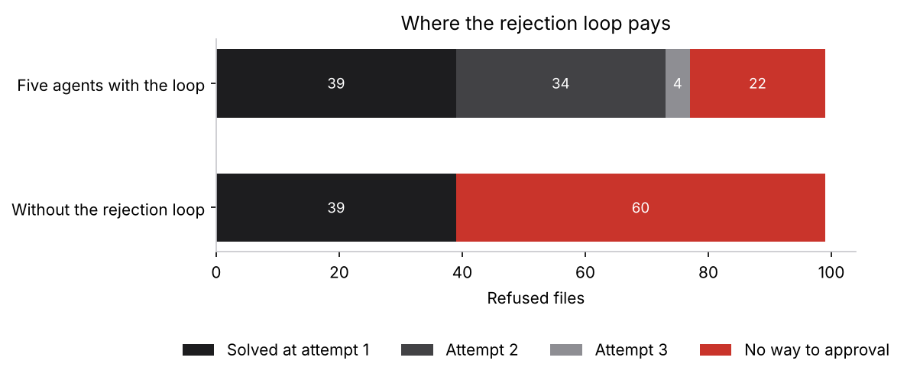
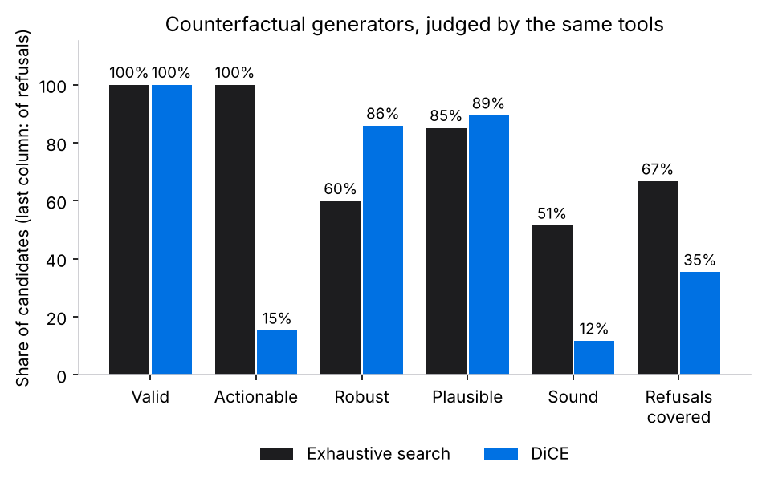

# Result analysis

Shared task S3, first version. Reading of the evaluation tables
(`eval/results/RESULTS.md`), with the figures of `eval/results/figures/` and
the limits of what they show. All figures: 200 held-out files, 99 of them
refused by the model, agents on rules. The runs with a language model are
not done yet (section 6).

## 1. The question

The module excludes "a predictive model behind an API". The evaluation
therefore asks what the agents add to the model: the same files go through
the full system, through the system with one part removed, and through a
script without agents. Every proposal a system hands to an applicant is
judged again by the same four tools, whatever the system claims: it must flip
the decision when re-scored, respect the recourse rules, clear the threshold
with a margin, and stay close to real past applicants. A proposal that
passes all four is called sound.

## 2. What a refused applicant receives

| System | Refusals with a sound way | Refusals handed an unsound proposal | Sensitive dependence caught |
|---|---|---|---|
| Five agents with the loop | 78% (77 of 99) | 0% | 22 of 22 |
| Without the rejection loop | 39% (39 of 99) | 0% | 22 of 22 |
| Without the auditor agent | 39% | 22% | 0 of 22 |
| Model + DiCE, no agents | 35% | 100% | 0 of 22 |

Three results follow.

**The loop doubles the recourse.** With one attempt, 39 refusals get a way to
approval. With the loop, 77 do. The 38 additional files are those where loan
terms alone were not enough and the auditor's objection sent the generator
to the financial situation (34 files at the second attempt) or to wider
ranges (4 at the third).

**The auditor is what makes the proposals safe to hand over.** Without it,
the generator's own flags let through proposals that flip the decision with
no margin (23% of what it delivers) or that describe a file unlike any real
applicant (16%). One refused applicant in five (22%) would receive at least
one such proposal. And none of the 22 files whose decision changes with sex
or foreign-worker status would be seen by anyone: they would be closed like
the others.

**A library call is not a recourse system.** DiCE alone produces 395
proposals; 12% are sound. It ignores the recourse rules: 85% of its proposals
ask for something the applicant cannot do. Half of those cut the amount or
the duration by more than 60%, a quarter move the account or the savings to
a state that cannot be reached, a fifth ask for a larger or longer loan. So
every refused applicant receives at least one unusable proposal. This is the
baseline "without agents": it is the same model and the same library the
agents use, without the plan, the rules and the audit.

How to read the 100% of the first two rows: the four checks are the ones the
auditor applies, so its output passes them by construction. The evidence is
in the other columns: coverage (78% against 39%), and what the systems
without the auditor deliver.

## 3. Cost of the verification

- Time: 104 ms per file for the full system against 49 ms for the script
  without agents. The loop accounts for most of the difference.
- Human workload: 48 files of 200 go to a reviewer. 22 because the decision
  depends on a sensitive attribute, 22 because no way to approval exists,
  4 because the score is on the threshold. Without the loop, 82 files would
  go to a reviewer: the loop also halves the human workload.
- Recourse lost to realism: before the plausibility check, 86 of 99 refusals
  had a way to approval; with it, 77. Nine applicants only had proposals
  that no longer looked like a real file. We count this as a gain in
  honesty, not as a loss, but it is a choice: the limit (95th percentile of
  real files) is a parameter.

## 4. The two generators

| | Exhaustive search | DiCE |
|---|---|---|
| Valid after re-scoring | 100% | 100% |
| Actionability rate | 100% | 15% |
| Robust | 60% | 86% |
| Plausible | 85% | 89% |
| Sound | 51% | 12% |
| Proximity (Gower distance, lower is closer) | 0.092 | 0.084 |
| Sparsity (attributes changed) | 2.2 | 2.0 |
| Refusals with a sound proposal | 67% | 35% |
| Time per file | 2 ms | 94 ms |

The exhaustive search is valid and actionable by construction: it only
enumerates permitted moves and only returns combinations it scored under the
threshold. It looks for the cheapest change, so 40% of its proposals land
just under the threshold without a margin; the auditor removes those. DiCE
overshoots (86% robust) but breaks the rules. The two are complementary,
which is why the generator uses both and the auditor filters both. The
exhaustive search is also about 45 times faster.

## 5. Fairness

| Attribute | Audited model | Model without protected attributes |
|---|---|---|
| Sex: approval gap (demographic parity difference) | 9 points (95% interval 1 to 24) | 1 point (0 to 18) |
| Age band: approval gap | 18 points (5 to 39) | 11 points (3 to 32) |
| Age band: equalized odds difference | 22 points | 20 points |
| Files whose own decision flips with a protected attribute | 11.0% | 0.0% |

- Removing the protected attributes removes the gap between women and men.
- It does not remove the gap for applicants aged 18 to 25: 11 points remain,
  with no access to age. The model rebuilds part of it from correlated
  attributes (time in employment, housing, property). "Fairness through
  unawareness" is therefore not enough here, and this is the reason for
  keeping both levels of test: the flip test says nothing about proxies.
- The foreign-worker comparison is not interpreted: 6 non-foreign files.
- All intervals are wide. With 200 files, a gap of 9 points between women
  and men is compatible with almost no gap. We report it, we do not claim it.

## 6. Limits

1. **No run with a language model yet.** Tables 1 to 4 use the agents on
   rules. The single-prompt baseline, the share of answers rejected by each
   guard, the fallbacks, tokens and latency need a provider key. The code is
   tested with a scripted model; `python eval/run_eval.py --llm` produces
   the tables.
2. **The judge and the auditor share their tools.** Soundness is measured
   with the checks the auditor applies. An independent criterion (for
   example a second model, or a human rating of a sample of proposals) would
   make the 100% a result instead of a property.
3. **Small, old data.** 1,000 files from one German bank in the 1990s, 200
   for the test. Fairness intervals are wide, and the model's accuracy
   advantage over a logistic regression is only established in
   cross-validation.
4. **Counterfactuals are about the model.** A way to approval says what the
   model would decide for the modified file. It is not a causal claim that
   the applicant would repay.
5. **Plausibility is a distance.** It compares a modified file with past
   files; it does not know that some combinations are impossible for other
   reasons (a guarantor may not exist). The reviewer and the applicant
   remain the judges of feasibility.
6. **The reviewer is not evaluated.** 48 files go to a person; the quality
   and the consistency of human decisions are outside this evaluation. The
   case store flags a near-identical file with the opposite outcome, which
   is a first control.
